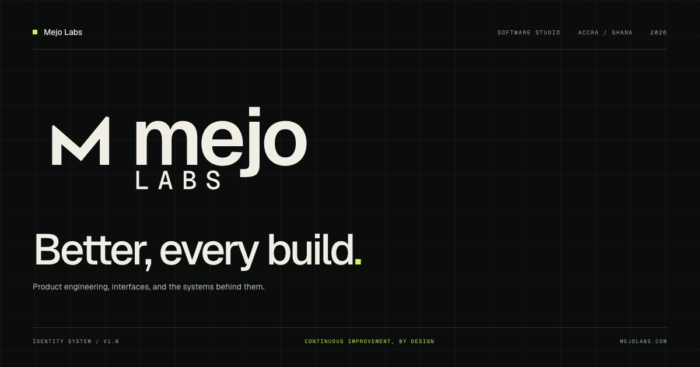

# Mejo Labs — studio website

The online home of **Mejo Labs**, a software studio in Accra, Ghana.

[**Visit the live site →**](https://pkaycodes.github.io/mejo-labs/)

[](https://github.com/pkaycodes/mejo-labs/actions/workflows/ci.yml)
[](https://github.com/pkaycodes/mejo-labs/actions/workflows/deploy.yml)
[](LICENSE)



## What this is

A static, dependency-free studio site built around the Mejo Labs identity:

- a sharp, typographic hero with a working code-card tab interaction;
- services, process, team and selected work;
- direct email, phone, WhatsApp and GitHub contact routes;
- real project links for Kae, Sharkbook, Sukuu, Shipcheck, Sikapos and Same Page;
- responsive navigation, keyboard support, visible focus states and reduced-motion support;
- social metadata, structured data, a sitemap and a custom 404 page.

The site is plain HTML, CSS and JavaScript. There is no framework, build step, tracker or
third-party script. That is deliberate: the studio's own site should load fast, work from
any static host, and remain easy to inspect.

## Run it locally

```bash
npm test
npm run serve
```

Open <http://localhost:4173>.

## Tests

```bash
npm test
```

The Node test suite checks the document head, canonical and social metadata, every
internal anchor and local asset, the selected-work links, the real contact routes,
accessibility affordances, the reduced-motion fallback, and that no analytics or
remote runtime scripts have crept in.

CI runs the suite on every push and pull request. Deployment runs the same tests,
copies the static files into an artifact, and publishes it to GitHub Pages.

## Structure

```text
index.html          the full page
styles.css          the design system and responsive layout
main.js             mobile navigation, tabs, clock and active-section state
assets/             logo, favicon, social card and self-hosted Geist fonts
test/site.test.mjs  dependency-free site checks
404.html            branded not-found page
robots.txt          crawler rules
sitemap.xml         canonical page list
```

## Identity

**Mejo** comes from *mejor* — better. The mark's right shoulder sits above its left:
every release should leave the work higher than it found it.

- Ink `#0B0D0C` · Bone `#F1EEE5` · Lime `#C9F45C` · Sage `#5F685C`
- Geist and Geist Mono, self-hosted under the SIL Open Font License.
- *Better, every build.*

## Deployment

Pushes to `main` deploy through `.github/workflows/deploy.yml`. The workflow:

1. runs the site tests;
2. copies only the public files into `_site`;
3. uploads the artifact and deploys it to GitHub Pages.

Any static host works: serve the repository root, or upload `index.html`, `styles.css`,
`main.js` and `assets/`.

## Contact

**Mejo Labs** · Accra, Ghana
[pkafrifamensa@gmail.com](mailto:pkafrifamensa@gmail.com) · +233 20 447 3247
[github.com/pkaycodes](https://github.com/pkaycodes)

## License

The site code is [MIT](LICENSE) © 2026 Papakwame Afrifa Mensa.
The Mejo Labs name, mark, wordmark and brand assets are © 2026 Mejo Labs. The bundled
Geist fonts are licensed under the SIL Open Font License 1.1.
